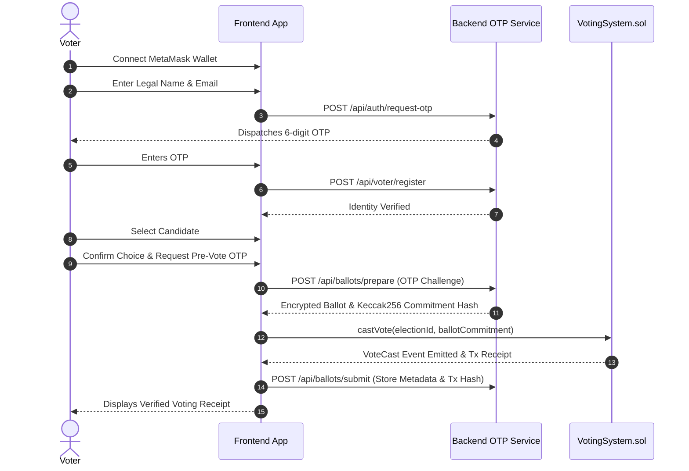

# Architecture & System Design

The **Blockchain Mini Voting System** (VoteSphere) is a decentralized, privacy-preserving, and verifiable digital election system built with a hybrid off-chain/on-chain architecture.

---

## 1. System Overview

```mermaid
graph TD
    subgraph Frontend["Client-Side (Next.js & MetaMask)"]
        UI[Modern Web Interface]
        Wallet[MetaMask Web3 Provider]
        Encryptor[Client-side Ballot Encryptor (AES-256)]
    end

    subgraph Backend["Off-Chain Layer (Express + SQLite + Prisma)"]
        AuthService[OTP Identity Verifier]
        BallotStore[Encrypted Ballot Store]
        TallyEngine[Admin Decryption & Tally Engine]
    end

    subgraph Blockchain["On-Chain Layer (Ethereum Smart Contracts)"]
        VotingContract[VotingSystem.sol]
        MultisigContract[AdminMultisig.sol (2-of-3)]
    end

    UI -->|1. Connect Wallet| Wallet
    UI -->|2. Verify Identity & OTP| AuthService
    UI -->|3. Request Encrypted Ballot & Commitment| Encryptor
    Encryptor -->|Store Ciphertext| BallotStore
    Wallet -->|4. castVote(ballotCommitment)| VotingContract
    MultisigContract -->|2-of-3 Governance Execution| VotingContract
    TallyEngine -->|Compute Result Hash| VotingContract
```

---

## 2. Key Components

### 2.1 Smart Contracts (`/contracts`)
- **`VotingSystem.sol`**:
  - Enforces one-wallet-one-vote using `mapping(uint256 => mapping(address => bool)) public hasVoted`.
  - Records on-chain cryptographic ballot commitments (`bytes32 ballotCommitment`).
  - Enforces election states (`NOT_CREATED`, `NOT_STARTED`, `OPEN`, `CLOSED`, `RESULTS_PUBLISHED`, `PAUSED`).
  - Validates `block.timestamp` against election start and end boundaries.
  - Receives and records final `resultHash`, `winnerCandidateId`, and tie status.
  - Implements OpenZeppelin `Pausable` for emergency freezes.
- **`AdminMultisig.sol`**:
  - Requires 2-of-3 authorized admin approvals to execute critical actions (open election, close election, publish results, emergency pause).

### 2.2 Backend & Off-Chain Database (`/backend`)
- **Prisma ORM with SQLite**:
  - `User`: Off-chain identity record (name, email, verified status) bound to wallet address.
  - `OtpVerification`: Salted SHA-256 hash of 6-digit OTPs, 10-minute expiry, rate limiting, single-use.
  - `Election`: Metadata and timing boundaries.
  - `Candidate`: Platform profiles, slogans, manifesto URLs, avatars.
  - `Ballot`: Stores AES-256-GCM encrypted vote payload mapped to `ballotCommitment` and `txHash`.
  - `AdminApproval`: Multi-sig proposals, signatures, and execution queue.

### 2.3 Frontend Application (`/frontend`)
- Next.js 14 App Router, TypeScript, Tailwind CSS, Lucide icons, ethers.js v6.
- Dark modern blockchain dashboard aesthetic.
- Seamless voter authentication, candidate selection, pre-vote OTP challenge, and MetaMask transaction submission.
- Real-time countdown timer, live block explorer links, and confetti celebration on receipt.

---

## 3. Voter Workflow Sequence


